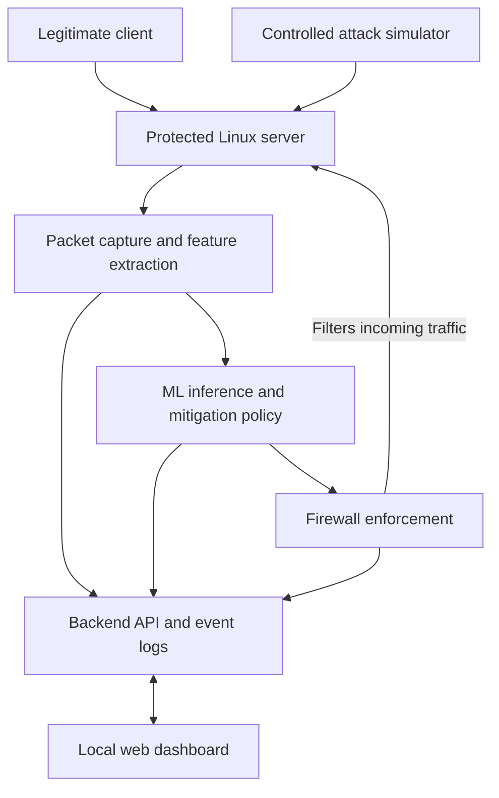

# ML-DDoS-Detector

COMP-3670 team project: machine learning based SYN and UDP flood detection with temporary firewall mitigation and a local web dashboard.

## Project status

Planning stage. The implementation and evaluation are not yet complete.

## Team

| Member | Role | Responsibilities |
| --- | --- | --- |
| Ayden | Lead Architect and ML Server Engineer | Architecture, training, inference, mitigation policy, backend API |
| Aadi | Documentation and Frontend Engineer | Dashboard, documentation, report coordination, presentation materials |
| Mujtaba | Client and Mitigation Engineer | Legitimate and controlled attack traffic, firewall enforcement, block expiry and cleanup |
| Ali | QA and Performance Engineer | Testing, experiment ground truth, measurements, charts and evaluation results |
| Vince | Infrastructure and Integration Engineer | Linux VM network, packet capture, shared feature extraction and deployment integration |

Each member writes the explanation of their own component. Aadi assembles and edits the report.

## Planned architecture

An isolated lab contains a legitimate client, a controlled attack simulator, and a protected Linux server. The server captures packets, extracts window features, runs inference, and applies temporary firewall blocks. A local browser dashboard uses the backend API to show traffic, detections, actions, and system health.

## Planned tools

Ubuntu Linux VMs, Python, Scapy, pandas, NumPy, scikit-learn, FastAPI, Uvicorn, iptables, HTML/CSS/JavaScript, Chart.js, Wireshark or tcpdump, pytest, Git, and GitHub.

Start with Random Forest, then compare an MLP after the end-to-end pipeline works. Offline and live processing must share the same feature definitions.

## Task workflow

Use Trello to assign and track tasks, and GitHub Issues for technical decisions and bugs:

**Backlog -> Ready -> In progress -> Review/testing -> Done**

Each task has one accountable owner, a deadline, a deliverable, dependencies, and a verifiable completion condition. Aim for one to three working sessions per task and review the board twice a week.

## Branch workflow

Work and integration happen on `development`. Once changes have been tested and reviewed, promote them to `main` through a pull request. `main` contains the tested version.

## Dashboard planning

See [the backend and frontend planning draft](docs/dashboard-plan.md) for the proposed agreement between Ayden and Aadi.

## First milestone

Demonstrate normal traffic, a controlled attack, detection, a temporary block, and measured legitimate client recovery. Compare no defense, monitor-only operation, simple rules, and ML mitigation.

## Lab scope

Traffic generation and mitigation experiments are intended for the isolated project lab.
