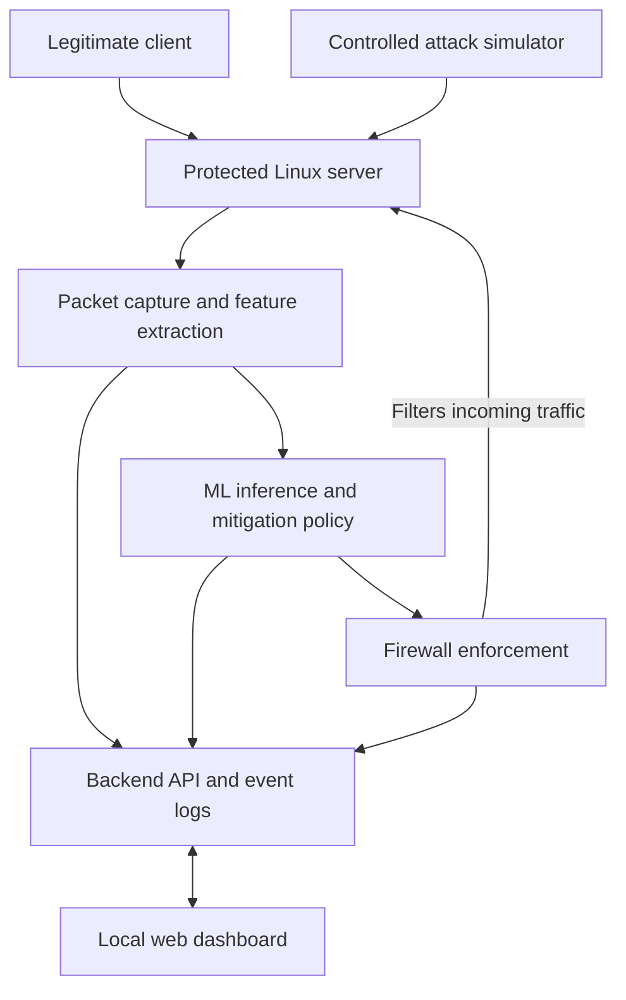

<a id="readme-top"></a>

<!-- PROJECT HEADER -->
<br />
<div align="center">
  <h1 align="center">ML-DDoS-Detector</h1>

  <p align="center">
    Machine-learning detection of SYN and UDP floods, with temporary firewall mitigation and a local web dashboard.
    <br />
    COMP-3670 team project
    <br />
    <br />
    <a href="docs/design.md"><strong>Explore the design docs »</strong></a>
    <br />
    <br />
    <a href="docs/lab-setup.md">VM lab setup</a>
    &middot;
    <a href="docs/api-contract.md">API contract</a>
    &middot;
    <a href="https://trello.com/b/7nOJyLqY/ml-ddos-detector">Trello board</a>
    &middot;
    <a href="https://github.com/aydsman/ML-DDoS-Detector/issues">Issues</a>
  </p>

  <p align="center">
    
    
    <a href="https://github.com/aydsman/ML-DDoS-Detector/actions/workflows/ci.yml"></a>
  </p>
</div>

<!-- TABLE OF CONTENTS -->
<details>
  <summary>Table of contents</summary>
  <ol>
    <li>
      <a href="#about-the-project">About the project</a>
      <ul>
        <li><a href="#built-with">Built with</a></li>
        <li><a href="#planned-architecture">Planned architecture</a></li>
      </ul>
    </li>
    <li>
      <a href="#getting-started">Getting started</a>
      <ul>
        <li><a href="#prerequisites">Prerequisites</a></li>
        <li><a href="#installation">Installation</a></li>
        <li><a href="#run-the-tests">Run the tests</a></li>
      </ul>
    </li>
    <li><a href="#repository-map">Repository map</a></li>
    <li><a href="#usage">Usage</a></li>
    <li><a href="#roadmap">Roadmap</a></li>
    <li><a href="#contributing">Contributing</a></li>
    <li><a href="#team">Team</a></li>
    <li><a href="#lab-scope">Lab scope</a></li>
    <li><a href="#acknowledgments">Acknowledgments</a></li>
  </ol>
</details>

<!-- ABOUT THE PROJECT -->
## About the project

Planning and early implementation. The detector, mitigation and evaluation are not yet complete.

An isolated lab contains a legitimate client, a controlled attack simulator, and a protected Linux server. The server captures packets, extracts window features, runs aggregate-window inference, and evaluates separate per-source attribution rules before requesting temporary firewall blocks. Startup defaults to monitor-only; enforcement requires validated policy settings. A local browser dashboard uses the backend API to show traffic, detections, actions, and system health.

The first milestone is to demonstrate normal traffic, a controlled attack, detection, a temporary block, and measured legitimate-client recovery, then compare four setups: no defense, monitor-only operation, simple rules, and ML mitigation.

See [the detection and mitigation design](docs/design.md) for IP-byte counting, aggregate detection, source attribution, and the pending dataset and policy decisions.

<p align="right">(<a href="#readme-top">back to top</a>)</p>

### Built with

* [![Python][Python-badge]][Python-url]
* Scapy, pandas, NumPy, scikit-learn (Random Forest first, then an MLP comparison)
* FastAPI and Uvicorn for the backend API
* iptables for mitigation
* HTML, CSS, JavaScript and Chart.js for the dashboard
* Ubuntu Linux VMs, Wireshark or tcpdump, pytest, Git and GitHub

Offline training and live capture must share the same feature definitions.

<p align="right">(<a href="#readme-top">back to top</a>)</p>

### Planned architecture



<p align="right">(<a href="#readme-top">back to top</a>)</p>

<!-- GETTING STARTED -->
## Getting started

Everything needed to run the current feature tests is below. No VM is needed for the feature tests, API planning, or frontend work. Full live capture and Linux firewall integration are tested in the isolated Linux lab described in [the lab setup notes](docs/lab-setup.md).

### Prerequisites

* Python 3.12. The repository's `.python-version` records the shared minor version; that file does not install Python by itself. Use an updated 3.12 patch release for your platform.
* Git

Each teammate creates their own `.venv` and installs dependencies locally.

### Installation

1. Clone the repository on the `development` branch

   ```sh
   git clone --branch development https://github.com/aydsman/ML-DDoS-Detector.git
   cd ML-DDoS-Detector
   ```

   For an existing checkout, save or commit your local changes first, then:

   ```sh
   git switch development
   git pull --ff-only origin development
   ```

2. Create the virtual environment and install dependencies

   **Windows PowerShell**

   ```powershell
   py -3.12 -m venv .venv
   .\.venv\Scripts\python.exe --version
   .\.venv\Scripts\python.exe -m pip install -r requirements.txt
   ```

   If `py -3.12` cannot find a uv-managed installation, run `py -0p` to list installed runtimes. For the uv-managed Python 3.12.15 installation use `py -V:Astral/CPython3.12.15 -m venv .venv`. If `.venv` already exists, use its Python directly. The explicit executable paths avoid requiring PowerShell activation or execution-policy changes.

   **Linux**

   ```sh
   python3.12 -m venv .venv
   ./.venv/bin/python --version
   ./.venv/bin/python -m pip install -r requirements.txt
   ```

3. In VS Code, open the repository folder and run `Python: Select Interpreter`. Choose `.venv/Scripts/python.exe` on Windows or `.venv/bin/python` on Linux, and confirm the Git branch is `development`.

### Run the tests

From the repository root:

```powershell
# Windows PowerShell
.\.venv\Scripts\python.exe -m pytest -q
```

```sh
# Linux
./.venv/bin/python -m pytest -q
```

The current tests cover the initial feature extractor and window grouping. Passing them does not validate live detection, model quality, or firewall mitigation. Dependency versions are not locked yet, so installations can resolve different package versions.

### Automated checks

[GitHub Actions](https://github.com/aydsman/ML-DDoS-Detector/actions/workflows/ci.yml) runs CI on pushes to `development` and `main`, and on pull requests targeting either branch. The workflow uses an isolated Ubuntu runner, reads the Python version from `.python-version`, installs `requirements.txt`, checks dependency consistency, and runs the pytest suite. Passing CI only verifies the tests currently present; it does not replace the isolated lab experiments. No deployment or automatic merge is configured.

<p align="right">(<a href="#readme-top">back to top</a>)</p>

<!-- REPOSITORY MAP -->
## Repository map

Start here if you are not sure where your work belongs. The "Main owner" column follows the roles in the [Team](#team) table.

| Path | What it is | Main owner |
| --- | --- | --- |
| `ddos_detector/` | Python package. Shared code for offline training and live capture. | Vince (feature extraction), Ayden (training, inference, API) |
| `ddos_detector/features.py` | The single feature extractor and window grouping. Offline and live processing must both use it. | Vince |
| `ddos_detector/config.py` | Shared settings (window length, data folder) and the feature name list. | Vince |
| `tests/` | pytest suite. `tests/test_features.py` covers the feature extractor and window grouping. | Ali (QA), everyone adds tests for their own code |
| `docs/design.md` | Design decisions: dataset, 1 second window, feature list, leakage rules, open items. | Ayden, Vince |
| `docs/test-plan.md` | Week 1 QA scenarios, acceptance checks, prerequisites, and owner review decisions. | Ali |
| `docs/measurement-formats.md` | Proposed metric definitions, collection methods, and experiment record format. | Ali, component owners review |
| `docs/templates/run-record.template.json` | Empty experiment record template; real run artifacts remain local and ignored. | Ali |
| `docs/lab-setup.md` | How to build the isolated three-VM lab, verify capture, and move it to another PC. | Vince |
| `docs/aadi-handoff.md` | Where Aadi starts on the dashboard and documentation. | Aadi |
| `docs/dashboard-plan.md` | Backend and dashboard planning agreement. | Ayden, Aadi |
| `docs/api-contract.md` | Proposed API field contract. Takes precedence over older examples. | Ayden |
| `docs/api-examples.json` | Mock JSON responses for building the dashboard. | Ayden, Aadi |
| `frontend/` | Dashboard source. Not created yet; Aadi adds it (see the handoff). | Aadi |
| `.github/workflows/ci.yml` | GitHub Actions CI. | Whole team |
| `requirements.txt` | Python dependencies. `.python-version` records Python 3.12. | Whole team |
| `data/` | Local datasets and captures. Gitignored, so it will not appear in a fresh clone. | Local only |

Not in the repository yet: packet capture, model training, the backend API, firewall mitigation, and experiment scripts. Add new code under `ddos_detector/` unless the team agrees otherwise, and mention the new file in this table.

<p align="right">(<a href="#readme-top">back to top</a>)</p>

<!-- USAGE -->
## Usage

There is no end-to-end pipeline to run yet. What you can do today:

* Run the feature-extraction tests (see [Run the tests](#run-the-tests)).
* Review the [QA test plan](docs/test-plan.md) and [measurement formats](docs/measurement-formats.md) before recording experiment results. Owner agreement and lab evidence are still pending.
* Build the isolated lab and verify packet capture with [the lab setup notes](docs/lab-setup.md).
* Build the dashboard against the mock responses in [`docs/api-examples.json`](docs/api-examples.json), starting from [Aadi's handoff](docs/aadi-handoff.md). See also the [backend and frontend planning draft](docs/dashboard-plan.md) and the [API field contract](docs/api-contract.md).

Usage examples for capture, training, and mitigation will be added as those parts land.

<p align="right">(<a href="#readme-top">back to top</a>)</p>

<!-- ROADMAP -->
## Roadmap

- [x] Design decisions: dataset, 1 second window, feature list, leakage rules
- [x] Shared feature extractor with tests, and CI
- [x] Isolated three-VM lab with verified packet capture
- [ ] Legitimate-traffic generator on the client VM
- [ ] PCAP reader and labelling
- [ ] Offline Random Forest model, then MLP comparison
- [ ] Live capture on the protected server
- [ ] Backend API
- [ ] iptables mitigation with block expiry and cleanup
- [ ] Dashboard
- [ ] Four-way experiment: no defense, monitor-only, simple rules, ML mitigation
- [ ] Final report and presentation

Weekly packages and deadlines are tracked on the [Trello board](https://trello.com/b/7nOJyLqY/ml-ddos-detector). Technical decisions and bugs go in [GitHub Issues](https://github.com/aydsman/ML-DDoS-Detector/issues).

<p align="right">(<a href="#readme-top">back to top</a>)</p>

<!-- CONTRIBUTING -->
## Contributing

Use Trello to assign and track tasks, and GitHub Issues for technical decisions and bugs:

**Backlog -> Ready -> In progress -> Review/testing -> Done**

Each task has one accountable owner, a deadline, a deliverable, dependencies, and a verifiable completion condition. Aim for one to three working sessions per task and review the board twice a week.

Work and integration happen on `development`. Once changes have been tested and reviewed, promote them to `main` through a pull request. `main` contains the tested version.

1. Pull the latest `development`
2. Create your feature branch (`git switch -c feature/short-name`)
3. Commit your changes with a clear message
4. Push the branch and open a pull request into `development`
5. Wait for CI to pass and for a teammate to review

<p align="right">(<a href="#readme-top">back to top</a>)</p>

<!-- TEAM -->
## Team

| Member | Role | Responsibilities |
| --- | --- | --- |
| Ayden | Lead Architect and ML Server Engineer | Architecture, training, inference, mitigation policy, backend API |
| Aadi | Documentation and Frontend Engineer | Dashboard, documentation, report coordination, presentation materials |
| Mujtaba | Client and Mitigation Engineer | Legitimate and controlled attack traffic, firewall enforcement, block expiry and cleanup |
| Ali | QA and Performance Engineer | Testing, experiment ground truth, measurements, charts and evaluation results |
| Vince | Infrastructure and Integration Engineer | Linux VM network, packet capture, shared feature extraction and deployment integration |

Each member writes the explanation of their own component. Aadi assembles and edits the report.

Project link: [github.com/aydsman/ML-DDoS-Detector](https://github.com/aydsman/ML-DDoS-Detector)

<p align="right">(<a href="#readme-top">back to top</a>)</p>

<!-- LAB SCOPE -->
## Lab scope

Traffic generation and mitigation experiments are intended for the isolated project lab only. Never send attack traffic to anything outside the lab network.

<p align="right">(<a href="#readme-top">back to top</a>)</p>

<!-- ACKNOWLEDGMENTS -->
## Acknowledgments

* [Best-README-Template](https://github.com/othneildrew/Best-README-Template) for the README layout
* [CIC-DDoS2019](https://www.unb.ca/cic/datasets/ddos-2019.html) for the dataset used in training

<p align="right">(<a href="#readme-top">back to top</a>)</p>

<!-- MARKDOWN LINKS & IMAGES -->
[Python-badge]: https://img.shields.io/badge/Python-3.12-3776AB?style=for-the-badge&logo=python&logoColor=white
[Python-url]: https://www.python.org/
