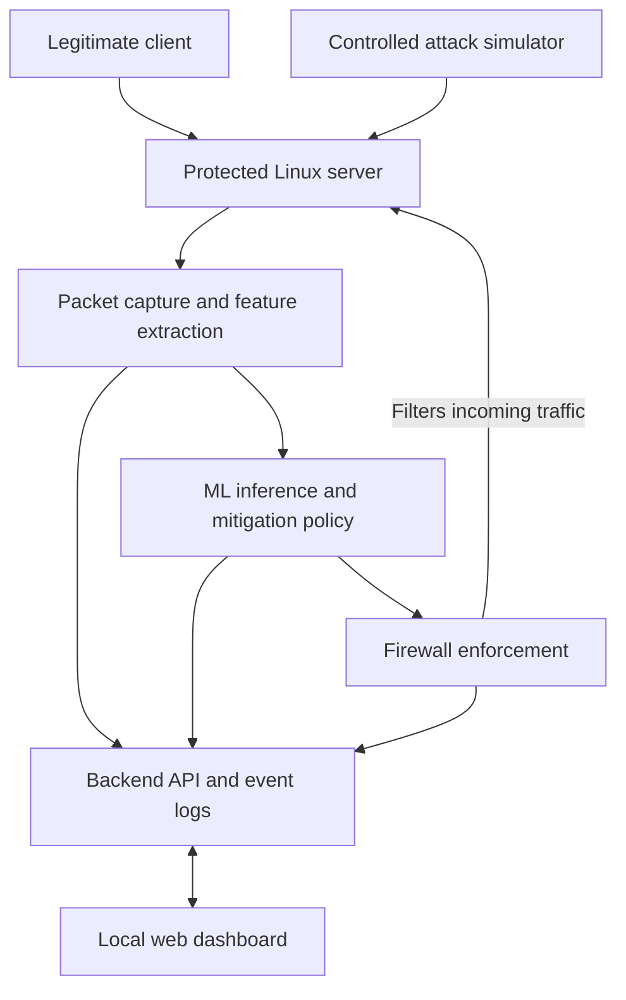

# ML-DDoS-Detector

COMP-3670 team project: machine learning based SYN and UDP flood detection with temporary firewall mitigation and a local web dashboard.

## Project status

Planning stage. The implementation and evaluation are not yet complete.

## Setup and tests

Use Python 3.12. The repository's `.python-version` records the shared minor version, 3.12; this file does not install Python by itself. Use an updated 3.12 patch release appropriate to your platform. Each teammate creates their own `.venv` and installs dependencies locally. No VM is needed for the current feature tests, API planning, or frontend work. Full live capture and Linux firewall integration are tested in Vince's isolated Linux lab.

### Get the code

For a new checkout:

```sh
git clone --branch development https://github.com/aydsman/ML-DDoS-Detector.git
cd ML-DDoS-Detector
```

For an existing checkout, save or commit your local changes before switching branches or pulling:

```sh
git switch development
git pull --ff-only origin development
```

### Windows PowerShell

Create the environment once, then install dependencies:

```powershell
py -3.12 -m venv .venv
.\.venv\Scripts\python.exe --version
.\.venv\Scripts\python.exe -m pip install -r requirements.txt
```

If `py -3.12` cannot find a uv-managed installation, run `py -0p` to list installed runtimes. For the uv-managed Python 3.12.15 installation, the environment creation command is:

```powershell
py -V:Astral/CPython3.12.15 -m venv .venv
```

If `.venv` already exists, use its Python directly; you do not need to recreate it. The explicit executable paths avoid requiring PowerShell activation or execution-policy changes.

### Linux

With Python 3.12 and its venv support installed:

```sh
python3.12 -m venv .venv
./.venv/bin/python --version
./.venv/bin/python -m pip install -r requirements.txt
```

### VS Code

Open the repository folder and run `Python: Select Interpreter` from the Command Palette. Select `.venv/Scripts/python.exe` on Windows or `.venv/bin/python` on Linux. Confirm the Git branch is `development`.

### Run the tests

Run from the repository root:

```powershell
# Windows PowerShell
.\.venv\Scripts\python.exe -m pytest -q
```

```sh
# Linux
./.venv/bin/python -m pytest -q
```

The current tests cover the initial feature extractor and window grouping. Passing them does not validate live detection, model quality, or firewall mitigation. Dependency versions are not locked yet, so installations can resolve different package versions.

## Team

| Member | Role | Responsibilities |
| --- | --- | --- |
| Ayden | Lead Architect and ML Server Engineer | Architecture, training, inference, mitigation policy, backend API |
| Aadi | Documentation and Frontend Engineer | Dashboard, documentation, report coordination, presentation materials |
| Mujtaba | Client and Mitigation Engineer | Legitimate and controlled attack traffic, firewall enforcement, block expiry and cleanup |
| Ali | QA and Performance Engineer | Testing, experiment ground truth, measurements, charts and evaluation results |
| Vince | Infrastructure and Integration Engineer | Linux VM network, packet capture, shared feature extraction and deployment integration |

Each member writes the explanation of their own component. Aadi assembles and edits the report.

## Planned architecture

An isolated lab contains a legitimate client, a controlled attack simulator, and a protected Linux server. The server captures packets, extracts window features, runs inference, and applies temporary firewall blocks. A local browser dashboard uses the backend API to show traffic, detections, actions, and system health.



## Planned tools

Ubuntu Linux VMs, Python, Scapy, pandas, NumPy, scikit-learn, FastAPI, Uvicorn, iptables, HTML/CSS/JavaScript, Chart.js, Wireshark or tcpdump, pytest, Git, and GitHub.

Start with Random Forest, then compare an MLP after the end-to-end pipeline works. Offline and live processing must share the same feature definitions.

## Task workflow

Use Trello to assign and track tasks, and GitHub Issues for technical decisions and bugs:

**Backlog -> Ready -> In progress -> Review/testing -> Done**

Each task has one accountable owner, a deadline, a deliverable, dependencies, and a verifiable completion condition. Aim for one to three working sessions per task and review the board twice a week.

## Branch workflow

Work and integration happen on `development`. Once changes have been tested and reviewed, promote them to `main` through a pull request. `main` contains the tested version.

## Dashboard planning

Start with [Aadi's frontend and documentation handoff](docs/aadi-handoff.md). See [the backend and frontend planning draft](docs/dashboard-plan.md), [API field contract](docs/api-contract.md), and [JSON examples](docs/api-examples.json) for the proposed agreement between Ayden and Aadi.

## First milestone

Demonstrate normal traffic, a controlled attack, detection, a temporary block, and measured legitimate client recovery. Compare no defense, monitor-only operation, simple rules, and ML mitigation.

## Lab scope

Traffic generation and mitigation experiments are intended for the isolated project lab.
