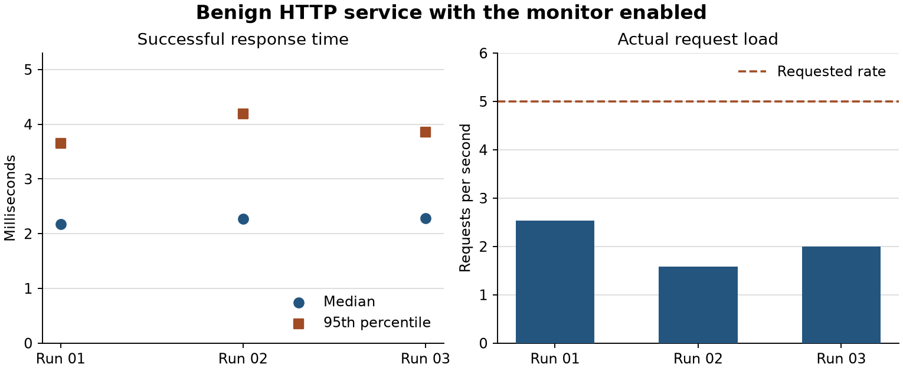

# Experimental method and available results

## Matched comparison

The four planned modes are no defense, monitor-only, rule-based mitigation and ML mitigation. Each matched group needs the same VM resources, service setup, workload schedule and collection interval. Record exact code, model and settings, unique trial and component IDs, clock uncertainty, and reset evidence between trials. Preserve each run and exclusion. Compare actual offered workload before comparing outcomes.

Ground truth comes from independent workload logs cross-checked with packet and timing evidence. Report detection counts with the number of observable incidents, and delay from confirmed onset through the first matching alert. Report false blocks against verified legitimate sources and confirmed action intervals. Calculate client success over actual attempts, and p50/p95 latency over successful attempts. Retain overhead and capture-health measurements with each trial. Keep unmeasured quantities unavailable. Use the agreed recovery rule to compare post-block availability and latency to the paired baseline. [Measurement definitions](../measurement-formats.md).

## Observed benign service

The surviving evidence covers three benign monitor-only lab runs. The archive used for this analysis has SHA-256 `3979d320fe760c0ad2e0b549c22d719fb3c330b18804651c0af2cdf9b0b572e6`. All 92 members matched its hash inventory. [Archived runs](https://github.com/aydsman/ML-DDoS-Detector/issues/48).

| Run | HTTP 200 / attempts | p50 (ms) | p95 (ms) | Achieved requests/s | Recorded lag skips |
| --- | ---: | ---: | ---: | ---: | ---: |
| 01 | 205/205 | 2.17 | 3.65 | 2.53 | 192 |
| 02 | 113/113 | 2.27 | 4.18 | 1.59 | 235 |
| 03 | 100/100 | 2.28 | 3.85 | 2.00 | 150 |

Client CSV and JSON pairs link by UUID. Request indexes are unique and UTC and epoch start fields agree within 2 μs. Latency percentiles use linear interpolation over sorted successful elapsed times for each run. Achieved rate divides actual attempts by reported elapsed time. All three targets were 5 requests/s. The exports predate the scheduled and cancelled counters required by the current full measurement validator. The achieved workload varied across runs, and the archive has no matched comparison across defense modes. The 173 scored windows had no alert. Post-window processing p95 ranged from 1.432 to 1.442 seconds. Monitor kernel-loss and resource-overhead values are unavailable. [Recomputed measurements](../reviews/ali-week5-benign-results.json).

## Separate validation results

Ayden's saved S2 validation report recorded 300 true negatives and 250 true positives with zero errors for each learned model. The aggregate rate rule recorded 296 true negatives, 4 false positives and 250 true positives. Its F1 is 500/504 = 0.9921, and its benign false-positive rate is 4/300 = 1.33%. S2 is one session and windows were selected after the agreed exclusions. The laptop inference benchmark measures warm single-window prediction. The held-out S3 results are pending the release procedure. [Model comparison](../model-comparison.md) · [Release plan](https://github.com/aydsman/ML-DDoS-Detector/pull/52).

## Pending final measurements

| Mode | Matched trial results |
| --- | --- |
| No defense | Pending matched evidence |
| Monitor-only | Benign integration results above. Matched incident/mixed trials pending. |
| Rule-based mitigation | Pending approved policy and Linux acceptance |
| ML mitigation | Pending approved policy and Linux acceptance |

The full comparison, detection delay, false-block and recovery estimates need matched incident/mixed trials. [Policy acceptance](https://github.com/aydsman/ML-DDoS-Detector/issues/51) · [Week 5 card](https://trello.com/c/7O6ZDZsb).
